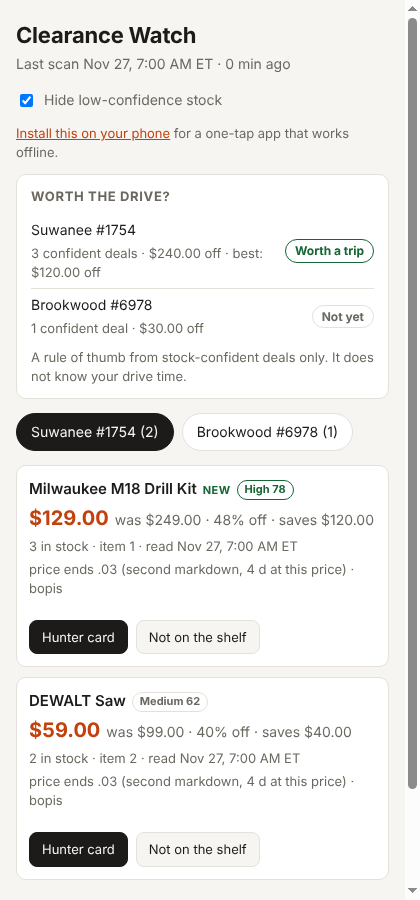
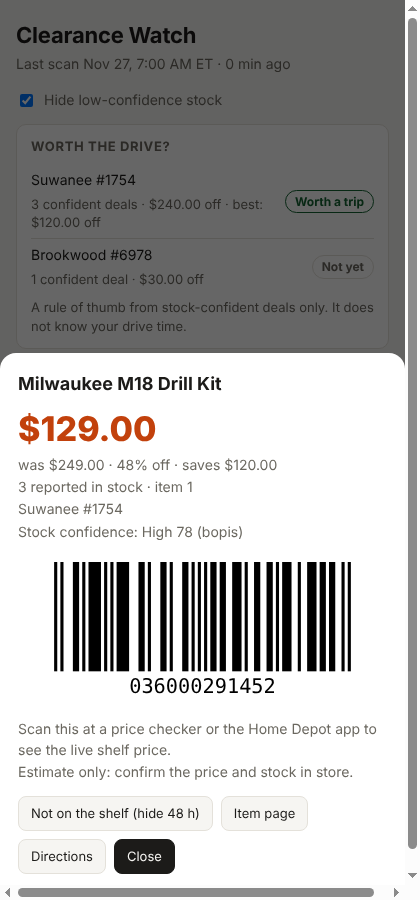

<div align="center">

# Clearance Watch

### Know which Home Depot clearance is actually on the shelf, before you drive.

A self-hosted scanner that watches the stores near you, scores every markdown for
**stock confidence**, and buzzes your phone only when a deal is worth the trip.
No account. No login. No checkout. Runs on your own machine.

[](https://github.com/manynames3/suwanee-clearance-watch/actions/workflows/ci.yml)


 &nbsp; 

<sub>Screenshots use sample data.</sub>

</div>

---

## The problem

Clearance is a **per-store** event. A drill marked down at your store is full price two
towns over, the markdown rarely shows up in search, and it's gone in days.

Then there's the other half: the tag says $40, the app says "3 in stock," you drive
twenty minutes, and the shelf is empty. A lot of clearance listings are **ghosts**:
stale counts, one-unit leftovers, seasonal items long since gone.

## What Clearance Watch does about it

It reads the stores you can actually drive to, and instead of handing you a raw list of
markdowns, it tells you **which ones are probably really there.**

| | |
|---|---|
| **Stock confidence, 0 to 100** | Every deal is scored from the evidence the scanner recorded: whether in-store pickup is live, whether the count is moving or has sat at 1–3 units for weeks, whether the item is seasonal, and whether several of your stores report healthy stock. The score is on every deal, with the reasons beside it. |
| **No-BS mode (on by default)** | Low-confidence ghosts are hidden from alerts and from the phone page. One toggle shows them again, so nothing is ever hidden without a way to inspect it. |
| **Markdown intelligence** | Tracks the price-ending cadence (`.00` then `.06`, `.03`, `.02`, `.01`), how many days an item has sat at its current price, and flags **inflated discounts**: "60% off" a list price the item rarely sold at. |
| **Stage-2 probe** | Before a top candidate reaches you, the scanner re-checks it with a single-item lookup. |
| **Worth the Drive** | Ranks your stores by the combined savings of their *confident* deals, with thresholds you set. |
| **In-aisle hunter card** | One tap puts the price, stock confidence and a scannable UPC barcode on your screen. It's drawn on your phone, with nothing sent anywhere. |
| **"Not on the shelf" in one tap** | Hide a ghost on this phone for 48 hours. |
| **Push where you already are** | ntfy, Pushover, Discord, Telegram, email or Slack, with **rule-based subscriptions** ("50% off or better, confidence 60+, Milwaukee only, this store") and de-duplication so a deal buzzes once. |
| **An installable phone app** | The deals page is a PWA: add it to your home screen, and it keeps working offline with the last scan it saw. |

```text
 Milwaukee M18 Drill Kit
 $129.00  (48% off)   stock confidence: High 78
 Suwanee · 3 in stock · price ends .03 (second markdown, 4 days at this price)
 Estimate only: verify in store
```

## Built to be trusted

Most scrapers fail quietly: they get throttled, return nothing, and report "no deals."
This one is built around the opposite rule: **a run that couldn't see everything says so.**

- **Never silently empty.** A throttled, truncated or refused scan raises `HEALTH_DEGRADED` and lists what it couldn't read. It never reports "no deals" after a partial run.
- **Soft-block detection.** A `200 OK` that's suspiciously empty for a category that used to be full is treated as a refusal, not as news.
- **Polite by design.** One request at a time, 4 to 10 seconds apart, with rest breaks. It slows itself down on a `429` and recovers gradually.
- **Tiered polling.** The expensive online-catalog tier runs at most once a day; the stores you care about are swept every run.
- **Stops when told to stop.** A `403`, a challenge page or a throttle writes a cooldown that survives restarts, and the next scan honours it.
- **Schema canary.** `hd canary` makes one ordinary request and checks the response against a typed contract, so a changed upstream shape is a specific message instead of a slow rot in your data.
- **Your data stays yours.** SQLite on your disk. The phone page holds no credentials and never talks to Home Depot. Price history is append-only and survives pruning.

## Get started

**From a ZIP code, in a few minutes:**

```bash
git clone https://github.com/manynames3/suwanee-clearance-watch.git
cd suwanee-clearance-watch
python3 -m venv .venv && source .venv/bin/activate
pip install -e ".[dashboard]"

hd init --zip 30024 --radius 25     # finds your nearest stores, sets up brands + schedule
hd run-once                         # first scan (10 to 30 minutes, paced on purpose)
hd alerts
```

`hd init --dry-run` shows the stores it found without writing anything. Any US ZIP works.

**Or with Docker:**

```bash
docker compose run --rm scanner hd init --zip 30024 --no-schedule
docker compose up -d                          # scans every 8 hours
docker compose --profile web up -d web        # optional: serve the phone page
```

**Phone alerts in one line** (ntfy shown; the rest are in [`.env.example`](.env.example)):

```bash
echo "NTFY_TOPIC=pick-a-long-random-topic" >> .env && hd notify-test
```

Five-minute walkthrough: [QUICKSTART.md](QUICKSTART.md). Full manual: [docs/REFERENCE.md](docs/REFERENCE.md).

## How the stock-confidence score works

No magic number: every point comes from a signal you can see on the deal.

| Signal | Effect |
|---|---|
| In-store pickup is live for the item | raises the score |
| Pickup shows "limited" | lowers it |
| Stock count is falling between scans (people are buying it) | raises it |
| Count frozen at 1 to 3 units for 10+ days | lowers it sharply |
| Looks seasonal (by title) and the count is small | lowers it |
| One unit left on a year-round item | lowers it |
| Three or more of your stores report healthy stock | raises it |
| Zero units | score is 0 |

Online "unavailable" is **not** penalised: clearance items usually can't be bought online.
The score is a transparent heuristic, not a measurement, so every deal shows its reasons.

## What it is, and what it isn't

Clearance Watch is honest about its limits, and you should be able to count on that:

- **Estimates, not guarantees.** Prices and counts come from public store data and can be stale or wrong. *Verify in store before you drive or buy.*
- **No aisle or bay locations.** The data the scanner reads doesn't contain them, so it doesn't pretend to.
- **Department grouping is a title heuristic.** Useful, not authoritative.
- **Price history is what *it* recorded.** The "usual price" is the median of the readings it has actually seen, and says how many days that covers. A brand-new install has little history.
- **Cross-store signals need two or more watched stores.**
- **"Worth the Drive" doesn't know your drive time.** It's a savings rule of thumb with thresholds you control.
- **Hiding a ghost is per phone.** The 48-hour hide lives in your browser; it doesn't change what the scanner or your other devices see.
- **It's a personal tool.** It reads the same public endpoints the website uses, slowly, for you. It logs in to nothing, buys nothing, and has no proxy rotation, CAPTCHA solving or bot evasion, and won't be given any. If Home Depot says stop, it stops.
- **Unofficial.** Not affiliated with, endorsed by, or sponsored by The Home Depot.

## Under the hood

Python 3.11+, async SQLAlchemy (SQLite or Postgres), Typer CLI, a curl transport, and a
retailer-adapter seam so the pipeline never talks to a store chain directly. Over 1,300
automated tests, lint and type checks in CI, and a Docker image.

```
hd init · run-once · alerts · doctor [--network] · canary · notify-test · serve · prune · backup
```

Contributor and architecture notes: [AGENTS.md](AGENTS.md). Release notes: [CHANGELOG.md](CHANGELOG.md).

## Credits and license

A fork of [KenStager/HDScanner](https://github.com/KenStager/HDScanner), extended with
stock confidence, push channels, the phone app, container packaging and ZIP-based setup.
MIT licensed: see [LICENSE](LICENSE). No warranty.

<sub>Inventory counts and prices are estimates. Verify in store.</sub>
